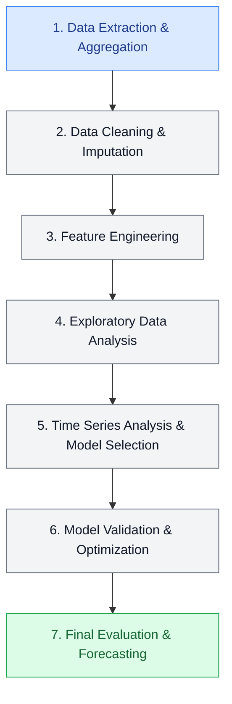

# NYC Taxi Demand & Weather Forecasting

Project of end-to-end time series data processing, feature engineering, and exploratory data analysis (EDA) combining NYC Yellow Taxi trip records and NOAA Central Park weather data from 2016 to 2019.

---

## Context & Objectives

The primary objective of this project is to prepare a clean, unified dataset combining daily NYC taxi demand with local weather metrics in order to build predictive models for 7-day short-term forecasting of taxi pickup counts.

---

## Datasets

The analysis leverages two public datasets hosted on **Google BigQuery**:

1. **NYC Yellow Taxi Trips** (`bigquery-public-data.new_york_taxi_trips.tlc_yellow_trips_20*`)
   - Daily aggregated total pickup counts in New York City from **2016 to 2019** (1,461 daily records).
2. **NOAA Global Surface Summary of the Day (GSOD)** (`bigquery-public-data.noaa_gsod.gsod20*`)
   - Central Park Weather Station (`WBAN: 94728`).
   - Features: Mean Temperature (`temp`), Wind Speed (`wdsp`), Precipitation (`prcp`), and Snow Depth (`sndp`).

---

## Pipeline & Methodology

This project combines NYC taxi trip data with historical weather observations to build a unified daily analytical dataset covering **2016–2019**.

### 1. Data Extraction & Aggregation
- Extract NOAA GSOD weather observations for Central Park (WBAN: 94728), covering 2016–2019.
- Aggregate NYC taxi trips by calendar day to compute `pickup_count`.
- Use SQL and BigQuery for data extraction and aggregation.

### 2. Data Cleaning & Imputation
- Convert NOAA placeholder values (`9999.9`, `999.9`, `99.99`) to `NULL`, as applicable to each variable.
- Impute missing snow depth (`sndp`) with `0.0`.
- Apply linear interpolation to missing wind speed (`wdsp`) observations.

### 3. Feature Engineering
- Merge taxi and weather datasets using the calendar date (`year`, `month`, `day`).
- Generate temporal features: `day`, `month`, `year`, and `day_of_week` (1–7).
- Extract `day_of_year` (1–366) to capture seasonal patterns.

### 4. Exploratory Data Analysis (EDA)
- Analyze taxi demand distributions and recurring temporal patterns.
- Explore relationships between weather conditions and taxi demand.
- Identify weekly and yearly seasonality.

### 5. Time Series Analysis & Model Selection
- Apply the Box-Jenkins methodology.
- Assess stationarity using the Augmented Dickey-Fuller test and analyze ACF/PACF plots.
- Identify SARIMA parameters using AIC and BIC.
- Explore SARIMAX models with exogenous variables and lagged demand features.

### 6. Model Validations & Optimization
- Apply time-series cross-validation with rolling windows.
- Evaluate feature combinations and compare model configurations using RMSE.
- Select the best-performing model based on validation results.

### 7. Final Evaluation & Forecasting
- Retrain the selected model on the combined training and validation data.
- Evaluate forecasting performance on the held-out test set.
- Analyze prediction accuracy, residual diagnostics, and model limitations.

### Output
The project combines NYC taxi trip records and NOAA weather data into a unified daily dataset (`taxi_weather_clean_daily.csv`) and develops a SARIMAX model to forecast taxi demand. The results show that including annual seasonality as an exogenous variable improves forecasting performance more than using weather variables or temporal features such as `day_of_week` and `day_of_year`.